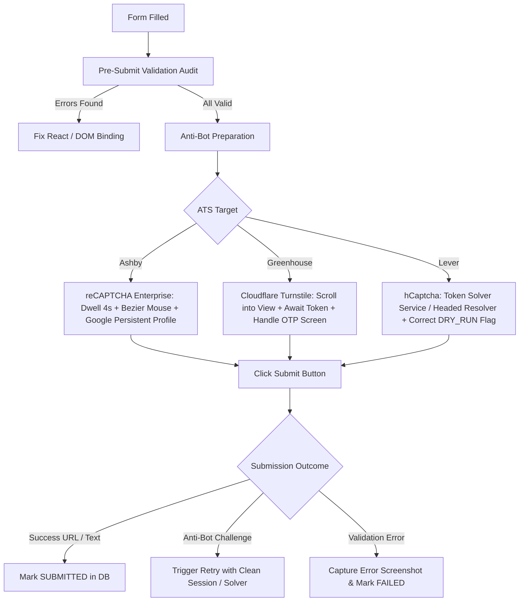

# ATS Final Submission Issue: Root-Cause Analysis & Technical Solutions

**Scope:** Greenhouse, Lever, Ashby  
**Document Version:** 1.0  
**Target Audience:** Engineering Leadership, QA, Automation Developers  

---

## Executive Summary

Across all three major Applicant Tracking Systems (**Greenhouse**, **Lever**, and **Ashby**), form auto-filling succeeds in populating visible fields, but final submission fails when clicking the submit button.

Our deep inspection of runtime logs, codebase adapters, database records, and captured failure screenshots reveals that the failures do not stem from basic form input syntax. Instead, they occur due to **three structural bottlenecks**:

1. **Anti-Bot Telemetry & Invisible Challenge Interception** (Impact: **Ashby, Greenhouse, Lever**)  
   Modern ATS platforms delay anti-bot scoring until the final submit action. At submission time, Google reCAPTCHA Enterprise (Ashby), Cloudflare Turnstile (Greenhouse), and hCaptcha (Lever) analyze browser automation signatures, mouse dynamics, and IP reputation, rejecting the submission before or during the HTTP POST request.

2. **Client-Side Framework State Desynchronization** (Impact: **Greenhouse, Lever**)  
   Modern ATS frontends (React / Vue) decouple the visible DOM from internal form state. Directly populating values or triggering naive clicks leaves hidden state variables empty, prompting client-side validation errors (*"This field is required"*) that silently block form submission.

3. **Codebase Logic Flaws & Configuration Defaults** (Impact: **Lever, Background Worker**)  
   Inverted environment checks (`process.env.DRY_RUN !== "false"`), test scripts omitting `adapter.submit(page)`, and worker queue whitelist filters prevent the submission pipeline from executing.

---

## High-Level Failure Matrix

| ATS Platform | Primary Root Cause | Secondary Root Cause | Failure Symptom |
|---|---|---|---|
| **Ashby** | **Google reCAPTCHA Enterprise** low trust score (<0.5) triggered by Playwright automation flags and datacenter IPs. | 3 applications per 60 days limit per candidate per company; async resume parser race. | Red error banner: *"We couldn't submit your application. Your application submission was flagged as possible spam."* |
| **Greenhouse** | **React SyntheticEvent & `react-select` state desynchronization** on required dropdowns. | Cloudflare Turnstile token failure; 8-character email OTP verification prompt. | Form blocked with *"This field is required"* or *"There was an error processing your application. Please try again."* |
| **Lever** | **Interactive hCaptcha visual puzzle** requiring manual interaction or token resolution. | `DRY_RUN !== "false"` bug skips submit; worker rejects `ats !== 'ASHBY' && ats !== 'GREENHOUSE'`. | Submission either skipped silently, times out after 90 seconds on hCaptcha, or fails on unselected location JSON. |

---

## Detailed Platform Deep Dives

---

### 1. Ashby

#### A. Root Causes

1. **Google reCAPTCHA Enterprise Invisible Scoring**
   * **Endpoint:** `POST /api/candidate-portal/job-board/.../apply`
   * **Mechanism:** Ashby does not use a traditional checkbox captcha. Instead, it embeds invisible reCAPTCHA Enterprise. When `Submit Application` is clicked, the script requests a token from Google (`grecaptcha.enterprise.execute`).
   * Google scores the session from `0.0` (bot) to `1.0` (human). Because standard Playwright/Chromium instances exhibit automation markers (CDP connection, missing natural user history, lack of long-lived Google auth cookies, rapid synthetic mouse jumps), Google issues a score < 0.5.
   * Ashby’s backend verifies this token with Google. If the score is low, the server rejects the payload with HTTP 400/403 and renders the exact error banner:
     > *"We couldn't submit your application. Your application submission was flagged as possible spam. Try these steps: Turn off your VPN or proxy, Pause browser extensions, Try another browser or device..."* (Verified from runtime screenshot `screenshots/worker_error_1787910326841.png`).

2. **Ashby 60-Day Candidate Rate Limit**
   * Handled in `src/ats/ashby/ashby.adapter.ts:817`.
   * Ashby enforces a strict rule: **a maximum of 3 applications per company over a rolling 60-day window**. If repeated test runs target the same organization with the same candidate email or profile identity, Ashby blocks the submission.

3. **Asynchronous Resume Parsing Race Condition**
   * Uploading a resume initiates an asynchronous parsing worker on Ashby's servers. If `submit` is triggered before the parser concludes, or if the parser rewrites candidate fields while the script is validating/submitting, the payload fails schema validation.

#### B. Technical Solutions for Ashby

* **Persistent Browser Contexts with Google Authentication:**  
  Use `chromium.launchPersistentContext()` referencing a dedicated user profile directory. Having authentic browser cache, history, and an active Google account session drastically elevates reCAPTCHA Enterprise trust scores from ~0.1 to >0.7.
* **Residential Proxy Network:**  
  Route Playwright traffic through dedicated residential or ISP proxies. Datacenter IP ranges (AWS, DigitalOcean, GCP) receive near-zero initial trust scores from reCAPTCHA.
* **Bezier Mouse Telemetry & Form Dwell Time:**  
  Before clicking `Submit Application`, simulate 3 to 5 seconds of natural human form review using Bezier mouse curves, intermediate scrolling, and micro-pauses:
  ```typescript
  await simulateHumanMouse(target);
  await page.waitForTimeout(3000 + Math.floor(Math.random() * 2000));
  await submitButton.scrollIntoViewIfNeeded();
  await humanClick(target, submitButton);
  ```
* **Enforce Parser Completion Guard:**  
  Wait explicitly for Ashby's upload indicator before filling or submitting:
  ```typescript
  await page.waitForSelector("[data-upload-state='complete'], [class*='uploadComplete']", { timeout: 15000 });
  ```

---

### 2. Greenhouse

#### A. Root Causes

1. **React State & `react-select` Desynchronization**
   * **Observed Evidence:** As captured on runtime tests (`screenshots/greenhouse-v2-1788436070857.png`), the candidate selected `"LinkedIn"`, yet Greenhouse marked the field with a red border and error message:
     > *"Where did you first hear about this role? This field is required."*  
     > *"Please double-check all the information provided above... This field is required."*
   * **Mechanism:** Modern Greenhouse boards (`job-boards.greenhouse.io`) run on React with custom dropdowns (`react-select`). The true state is held in internal React component state and synced to hidden inputs. Naive typing or un-scoped dropdown clicks do not fire React's synthetic event bubble. As a result, React considers the required fields empty, and the browser's form submission is canceled before any network request occurs.

2. **Cloudflare Turnstile Anti-Bot & Backend Processing Error**
   * Greenhouse deploys **Cloudflare Turnstile** (visible on the bottom-right corner of modern job boards).
   * If the automated context exhibits bot traits or fails Turnstile's execution token check, the backend responds with the generic error:
     > *"There was an error processing your application. Please try again."* (logged in `src/ats/greenhouse/greenhouse.adapter.ts:709`).

3. **Greenhouse 8-Character Human Verification (OTP)**
   * When Greenhouse suspects bot behavior, rapid sequential applications, or unverified IPs, it halts submission and prompts:
     > *"Enter the 8-character verification code sent to your email to confirm you're human."*
   * Without an automated mail listener, the script stalls and times out.
   * Greenhouse also rejects sub-addressed emails (e.g. `user+tag@gmail.com`) through its verification delivery system.

#### B. Technical Solutions for Greenhouse

* **Aria-Controls Scoped Selection & Synthetic Event Dispatch:**  
  Use the verified dropdown selection pattern from `scratch/test-greenhouse-filling.ts`:
  ```typescript
  // 1. Click select control wrapper
  await page.evaluate((id) => {
    const input = document.getElementById(id);
    let el = input;
    while (el && !el.classList.contains("select__control")) el = el.parentElement;
    if (el) {
      el.dispatchEvent(new MouseEvent("mousedown", { bubbles: true }));
      el.dispatchEvent(new MouseEvent("click", { bubbles: true }));
    }
  }, comboboxId);

  // 2. Identify the exact aria-controls listbox to avoid menu cross-contamination
  const listboxId = await page.getAttribute(`#${comboboxId}`, "aria-controls");
  const optionLocator = page.locator(`#${listboxId} [role="option"]`).filter({ hasText: matchRegex });
  await optionLocator.click({ force: true });
  ```
* **Pre-Submit Validation Assertion:**  
  Before clicking the submit button, query for any visible error elements:
  ```typescript
  const errors = await page.locator(".error:visible, .field-error:visible, [aria-invalid='true']").count();
  if (errors > 0) throw new Error("CLIENT_VALIDATION_FAILED: Resolve required fields before submit");
  ```
* **Cloudflare Turnstile Dwell:**  
  Scroll to the bottom of the page 2 seconds prior to submission. Allow the Cloudflare Turnstile widget to verify execution and attach `cf-turnstile-response` to the form.
* **Automated OTP Email Verification Service:**  
  Implement an IMAP/Gmail API webhook to poll the inbox for Greenhouse's 8-character code and input it into the verification field automatically.

---

### 3. Lever

#### A. Root Causes

1. **Interactive hCaptcha Challenge Modal**
   * **Mechanism:** Lever job postings (`jobs.lever.co/.../apply`) deploy **hCaptcha**.
   * When an automated Playwright session clicks `#btn-submit`, hCaptcha detects the automation environment and presents an interactive visual puzzle (*"Select all images containing a bus/train"*).
   * In automated or headless runs without manual intervention, `textarea[name="h-captcha-response"]` remains empty, causing the application to hang or timeout.

2. **Inverted `DRY_RUN` Configuration Bug in Adapter**
   * In `src/ats/lever/lever.adapter.ts:405`:
     ```typescript
     if (process.env.DRY_RUN !== "false") {
       console.log("🟡 [LeverAdapter]: Dry-run enabled. Skipping live submission click.");
       return { success: true, confirmation: "DRY_RUN_SUCCESS" };
     }
     ```
   * When `DRY_RUN` is undefined or not explicitly `"false"`, Lever skips clicking submit completely.
   * Additionally, standalone scripts such as `src/scripts/seed-and-apply-lever.ts` only invoked `fillForm()` and `validate()`, **never calling `adapter.submit(page)`**.

3. **Background Worker Whitelist Exclusion**
   * In `src/scheduler/application-worker.ts:177`:
     ```typescript
     if (ats !== "ASHBY" && ats !== "GREENHOUSE") {
       throw new Error(`ATS_NOT_SUPPORTED: ${ats}`);
     }
     ```
   * Any Lever job queued in the background worker immediately fails with `ATS_NOT_SUPPORTED: LEVER`.

4. **Location Autocomplete Hidden JSON Binding**
   * Lever’s location input is backed by a Twitter Typeahead autocomplete service. Typing text without selecting from the `.tt-suggestion` dropdown leaves `input[name="selectedLocation"]` null, failing backend validation.

#### B. Technical Solutions for Lever

* **Correct the DRY_RUN Logic & Whitelist in Worker:**
  ```typescript
  // Fix in lever.adapter.ts
  const isDryRun = process.env.DRY_RUN === "true";
  if (isDryRun) { /* skip */ }

  // Fix in application-worker.ts
  if (ats !== "ASHBY" && ats !== "GREENHOUSE" && ats !== "LEVER") {
    throw new Error(`ATS_NOT_SUPPORTED: ${ats}`);
  }
  ```
* **hCaptcha Token Injection via Solver Service:**  
  Integrate an automated CAPTCHA solver (e.g. CapSolver or 2Captcha) to retrieve a valid token and inject it prior to clicking submit:
  ```typescript
  await page.evaluate((token) => {
    const el = document.querySelector("textarea[name='h-captcha-response']") as HTMLTextAreaElement;
    if (el) el.value = token;
  }, captchaToken);
  ```
* **Strict Typeahead Selection for Location:**
  ```typescript
  await page.fill("#location", "Vadodara");
  await page.waitForSelector(".tt-suggestion", { timeout: 4000 });
  await page.click(".tt-suggestion:first-child");
  ```

---

## Action Plan & Implementation Roadmap



### Immediate Code Fixes Checklist

- [ ] **Lever Adapter (`src/ats/lever/lever.adapter.ts`)**: Replace `if (process.env.DRY_RUN !== "false")` with `if (process.env.DRY_RUN === "true")`.
- [ ] **Worker Queue (`src/scheduler/application-worker.ts`)**: Add `"LEVER"` to supported ATS checks.
- [ ] **Lever Seed Script (`src/scripts/seed-and-apply-lever.ts`)**: Add `const submitRes = await adapter.submit(page);`.
- [ ] **Greenhouse Dropdowns (`src/ats/greenhouse/greenhouse.adapter.ts`)**: Replace generic select clicks with the scoped `fillReactSelect` function from `scratch/test-greenhouse-filling.ts`.
- [ ] **Ashby Automation Context (`src/browser/browser-manager.ts`)**: Route Ashby jobs through `createPersistentBrowserContext()` with residential proxy settings.
- [ ] **CAPTCHA Handling**: Integrate automated solver provider (e.g. CapSolver API) for headless execution.
